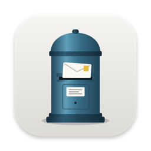
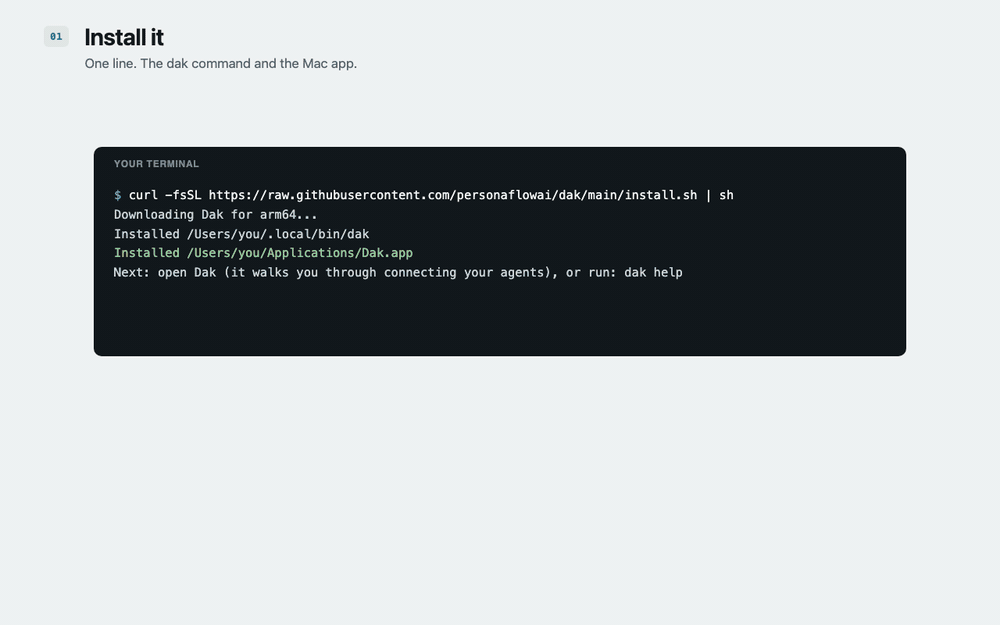

<p align="center"></p>

<h1 align="center">Dak</h1>

<p align="center"><b>A review inbox and message queue between you and the AI coding agents on your Mac.</b><br>
Claude Code, Codex, Cursor and your own scripts send you PRs, docs and questions in one place. Your answer goes straight back into their session.</p>

<p align="center">
  <a href="https://github.com/personaflowai/dak/releases/latest"></a>
  
  <a href="LICENSE"></a>
</p>

<p align="center"></p>

<p align="center"><a href="https://github.com/personaflowai/dak/releases/download/v0.4.0/dak-demo.mp4">▶ Watch the 56-second video</a> (with sound)</p>

```bash
curl -fsSL https://raw.githubusercontent.com/personaflowai/dak/main/install.sh | sh
```

Dak (डाक, "the post") gives every agent on your machine (Claude Code, Cursor, Codex, Grok, your own scripts) one place to send you work and get your answer back. A PR arrives as chapters you can read in order, with the diff, the whole file and a helper that explains any line. A brief arrives as a rendered document you can comment on paragraph by paragraph. You pick a verdict, press Send, and the agent that asked gets your comments as JSON on the same thread.

## What it does

- **One conversation per agent.** Every PR, doc or question an agent sends is a topic in that conversation. Mark a topic done, archive a quiet agent, and read what agents say to each other under "Between agents".
- **PRs explained in chapters.** The agent that wrote the change explains it: why each part exists, the risk and how it is proven, what to check. You read the notes beside the code, comment on any line, and approve or ask for changes in one place. ⌘F finds anything in the diff.
- **Docs to comment on.** A brief arrives as a document; select words or a paragraph and comment there.
- **Answers that travel back.** Your verdict and comments reach the agent's session as JSON. Agents can offer buttons, so a choice is one click.
- **Push, not polling.** Connected Claude Code sessions get your reply at the next turn, and an idle session is woken when mail arrives. Codex and Cursor get it at the edges of their turns.
- **Waiting on you, in one order.** Every PR, brief and decision that needs you, ordered by priority with what each answer releases. Agents propose the order (`dak queue review-order`); drag a row and your order wins. "I'm reviewing" tells the agent you have started.
- **The merge queue.** Merge scripts report each PR's state (`dak queue set 412 --state testing --eta 6m`), and Dak shows what is running, what is next and how long is left.
- **On your phone.** Settings → Your phone opens a private link (a Cloudflare quick tunnel, guarded by a key) to read PRs, open files, approve and reply from anywhere. Add it to the home screen and it opens like an app.
- **Wakes closed sessions.** When you answer a Claude Code session that has closed, Dak resumes it in the background to read the reply, and tells you when it has.
- **Agents outside the Mac.** Open a door in Settings and a remote agent (Grok, a cloud runner) sends and replies over HTTPS with its own key, under its own name.
- **Notifications, search and a helper.** A banner when something needs you, ⌘K across every conversation, and a read-only helper (Claude Code, Codex or Cursor) to explain any line.

Everything stays on your Mac: one SQLite file, a localhost server, no accounts. Opening the phone link or the door for outside agents routes those requests through a Cloudflare quick tunnel; both are off until you turn them on.

## Install

macOS 13 or later.

```sh
curl -fsSL https://raw.githubusercontent.com/personaflowai/dak/main/install.sh | sh
```

That puts the `dak` command in `~/.local/bin` and Dak.app in `~/Applications`, for Apple silicon or Intel. Open Dak: the first screen connects your agents (Claude Code, Codex, Cursor) and sends you a test message. For PRs from GitHub, install the [`gh`](https://cli.github.com) CLI.

The app is not notarized yet; the install script clears the download flag on the copy it installs so macOS opens it.

From source (needs [Bun](https://bun.sh) 1.1.42+):

```sh
git clone https://github.com/personaflowai/dak && cd dak
bun install
bun run build && ln -s "$PWD/dist/dak" ~/.local/bin/dak
sh mac/build.sh --install      # the Mac app, into ~/Applications
```

Without the Mac app, `dak serve` and open http://127.0.0.1:7474.

## Sending (for agents)

```sh
# A PR, in chapters
dak send --to you --from atlas --pr 2396 --chapters chapters.json "Ready for your glance."
dak send --to you --from atlas --base main --chapters chapters.json     # this branch against main

# A doc to review, a file, a link
dak send --to you --from mitra --doc docs/brief.md "Two open questions at the end."
dak send --to zari --from grok --file cut-3.mp4 "Cut 3 is ready"

# Wait for the answer (exit 0 with the reply, exit 2 on timeout)
dak wait t_8f2c --for atlas --timeout 15m --json
```

What comes back:

```json
{ "messages": [{ "author": "you", "verdict": "changes", "body": "Close. One question.",
  "comments": [{ "anchor": { "kind": "code", "file": "src/core/work/actions.ts", "side": "new", "start_line": 66, "end_line": 68 },
                 "body": "Who else calls writerFor?" }] }] }
```

`docs/agents.md` is the full guide for agents, including the chapters format. Connecting a tool in Dak's Settings also teaches it to use Dak:

- Claude Code gets the Dak skill at `~/.claude/skills/dak/` (left alone if you linked that folder yourself).
- Codex gets a marked Dak section in `~/.codex/AGENTS.md`, its global instructions.
- Cursor keeps global rules in its own settings, so Settings has a Copy instructions button to paste into Cursor's User Rules.
- Any other agent: `dak skill --plain` prints the same instructions.

Disconnecting removes only what Dak added. To work on the skill itself, link it from a checkout instead: `ln -s "$PWD/skills/dak" ~/.claude/skills/dak`.

## How it works

| Piece | Where |
|---|---|
| Store | `~/.dak/dak.db` (SQLite, WAL) and `~/.dak/blobs/` (attachments by SHA-256) |
| Readers | `~/.dak/config.toml`. Anyone may send; only readers receive. |
| CLI | `src/cli.ts`, writes the store directly, so it works with no server running |
| Server | `src/server.ts`, 127.0.0.1 only; checks Host, Origin and the token in `~/.dak/token` |
| Screens | `ui/`, plain TypeScript, highlight.js and markdown-it, bundled by Bun and embedded in the binary |
| Mac app | `mac/`, an AppKit shell around the screens: window, menu bar, notifications, start at login |
| Explain | `src/explain.ts` runs a read-only helper (`claude -p` by default; `codex exec` or `cursor-agent -p` in config) |

A PR is snapshotted when it is sent: the diff, the head commit and each changed file go into the blob store, so the review still opens after the branch is rebased or deleted.

## Releasing

Push a tag (`git tag v0.2.0 && git push --tags`): the release workflow tests, builds the CLI and the app for Apple silicon and Intel, and attaches them to a GitHub release with checksums. `install.sh` installs from the latest release.

Those builds carry an ad-hoc signature. To notarize, so a downloaded app opens with no warning, `mac/release.sh` signs with a Developer ID; its header lists the one-time setup (an Apple Developer account, its certificate and a notarytool profile).

## What is kept, and for how long

Everything, until you delete it. Nothing expires and nothing leaves the Mac, except a GitHub review you choose to post and what you open to the phone link or the door.

- `~/.dak/dak.db`: threads, messages, comments, verdicts and button picks.
- `~/.dak/blobs`: PR diffs, file snapshots, docs and images, stored once by content.
- The app's own storage (`~/Library/WebKit/dev.dak.app`): where you were reading, Reviewed ticks, draft comments and unsent replies.

Delete `~/.dak` to start over.

## Develop

```sh
bun test                        # builds the screens, then runs the CLI and HTTP tests on a throwaway store
DAK_DEV=1 DAK_HOME=/tmp/dak-dev bun src/cli.ts serve   # screens read from dist/ui on every request
bun run build:ui                # after changing ui/
```

## Licence

MIT. See `LICENSE`.
